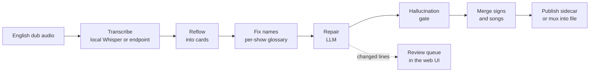

# DubTitlerr

[](https://github.com/XenaRathon/DubTitlerr/releases/latest)
[](https://github.com/XenaRathon/DubTitlerr/pkgs/container/dubtitlerr)
[](LICENSE)


DubTitlerr transcribes English dub audio into subtitles and merges on-screen signs and songs into the same track.

## The problem

The English subtitles shipped with most anime translate the Japanese script, not the English dub, so watching dubbed with them on gives you two scripts at once.
Meanwhile the translated on-screen signs and songs live on a separate track, and most players show only one subtitle track at a time.
DubTitlerr produces one track that carries the dub dialogue with the signs and songs merged in.

## What this fork adds

Upstream DubTitlerr bakes a Whisper model into a ~13 GB image, needs an NVIDIA GPU for transcription, and muxes the result into the video file. This fork keeps all of that working but adds three things:

| Addition | Why | Where |
| --- | --- | --- |
| **Endpoint ASR backend** (`ASR_BACKEND=endpoint`) | Transcribe through any OpenAI-compatible `/audio/transcriptions` — OpenRouter, a llama-swap whisper, a Nous gateway — so a node needs no model, no torch, no GPU and no CUDA | `generate.py` |
| **Lite image** (`Dockerfile.lite`) | 933 MB instead of 13.1 GB. Python-slim + ffmpeg + mkvtoolnix + pysubs2, no model baked in | `Dockerfile.lite` |
| **Sidecar delivery and adoption** (`OUTPUT_MODE=sidecar`, `ADOPT_DUB_EN=1`) | Publish `<episode>.dub.en.ass` beside the video instead of rewriting it, and run an existing sidecar from another pipeline through repair + signs merge | `merge_pass.sh`, `mux.py`, `publish_gate.py` |

Everything downstream of transcription — reflow, glossary correction, LLM repair, hallucination gate, signs/songs merge, QC — is unchanged and runs identically on both backends.

## How it works



- Transcribe the English dub audio, either in-process with Whisper (large-v3-turbo by default) or through an OpenAI-compatible endpoint, then reflow words into clean cards (at most 2 lines, 42 chars, about 17 cps, never shown before spoken).
- Correct names against a per-show glossary (curated hard_fixes plus a guarded fuzzy match, mined from your files and wiki-verified).
- Repair low-confidence and name-suspect lines with an LLM over any OpenAI-compatible endpoint, anchored on the embedded fansub dialogue when present.
- Drop hallucinated music, silence, and blocklist lines, collapse runaway repeats, and flag the uncertain for review.
- Merge the on-screen signs and song lyrics into the same subtitle.
- Publish `<episode>.dub.en.ass` beside the video (sidecar mode) or mux it in as a default Dubtitles track with the MKV fonts.
- Re-run safely: a version-stamped `.dubtitles.done` sidecar makes the pipeline idempotent and incremental.

## ASR backends

`ASR_BACKEND` selects where transcription happens. Everything else in the pipeline is backend-agnostic.

| Variable | Default | Meaning |
| --- | --- | --- |
| `ASR_BACKEND` | `local` | `local` uses in-process faster-whisper; `endpoint` posts to an OpenAI-compatible transcription API |
| `ASR_URL` | `https://openrouter.ai/api/v1/audio/transcriptions` | Endpoint URL. Must be the full `/audio/transcriptions` path |
| `ASR_MODEL` | `openai/whisper-1` | Model name sent to the endpoint (`whisper-large-v3-turbo` for llama-swap) |
| `ASR_KEY_ENV` | `OPENROUTER_API_KEY` | Name of the environment variable holding the key; only that variable is read. Set it empty for a keyless endpoint. A key is only sent over https, or plain http to loopback: any other URL refuses the run before an episode is touched |
| `ASR_TIMEOUT` | `900` | Per-request timeout in seconds |
| `ASR_REFERER` | fork repo URL | Sent as `HTTP-Referer` to OpenRouter only |

Notes:

- Audio is converted to a 32 kbps mono mp3 before upload. A 24-minute episode is ~46 MB as 16 kHz wav and ~5.5 MB as that mp3; OpenRouter rejects uploads over 25 MB.
- The request asks for `verbose_json` with `timestamp_granularities[]=word`. An endpoint that returns only segment timestamps still works — each segment becomes one timed "word", which the reflow stage handles.
- The local model is never loaded in endpoint mode, and `faster_whisper` is an optional import, so the lite image can run the same code.
- `lastrun.json` records `backend`, `model` and `url` instead of a decoder name, so a run's provenance says which endpoint produced it.

Example — OpenRouter:

```sh
ASR_BACKEND=endpoint
ASR_URL=https://openrouter.ai/api/v1/audio/transcriptions
ASR_MODEL=openai/whisper-1
ASR_KEY_ENV=OPENROUTER_API_KEY
OPENROUTER_API_KEY=sk-or-v1-...
```

Example — a llama-swap whisper on the LAN (no key):

```sh
ASR_BACKEND=endpoint
ASR_URL=http://your-host:11434/v1/audio/transcriptions
ASR_MODEL=whisper-large-v3-turbo
ASR_KEY_ENV=          # keyless; a key is never sent over plain http to another machine
```

Measured on an 892-episode library: local CPU int8 at beam 7 runs 3.2× realtime; llama-swap's `whisper-large-v3-turbo` on a current GPU runs ~11× realtime; OpenRouter `whisper-1` costs $0.006/min (~$0.14 per 24-minute episode).

## Images

| Image | Size | Contains | Use |
| --- | --- | --- | --- |
| `ghcr.io/xenarathon/dubtitlerr:v0.3.0` | ~13.1 GB | Full upstream release: Whisper model, torch, ctranslate2 | `ASR_BACKEND=local`, GPU or CPU |
| `dubtitlerr:lite` | 933 MB | `python:3.11-slim` + ffmpeg + mkvtoolnix + pysubs2 + this fork's scripts | `ASR_BACKEND=endpoint` |

```sh
# full image (upstream), local ASR
docker compose up -d

# lite image, endpoint ASR
docker build -f Dockerfile.lite -t dubtitlerr:lite .
docker run -d --name dubtitlerr --network host \
  -v /path/to/anime:/media/anime-tv -v /path/to/config:/config \
  -e ANIME_ROOT=/media/anime-tv -e MERGE_ROOTS=/media/anime-tv \
  -e ASR_BACKEND=endpoint -e ASR_URL=https://openrouter.ai/api/v1/audio/transcriptions \
  -e ASR_MODEL=openai/whisper-1 -e OPENROUTER_API_KEY=sk-or-v1-... \
  -e OUTPUT_MODE=sidecar -e SIDECAR_SUFFIX=.dub.en \
  dubtitlerr:lite
```

Both images need `mkvtoolnix` — the merge stage shells out to `mkvmerge` to read the video's subtitle streams and attachments. A lite build without it fails at the first merge pass with `FATAL: mkvmerge not found — image is misbuilt`.

## Requirements

- Transcription: **either** an NVIDIA GPU with CUDA for local Whisper (6 GB is enough at int8) **or** an OpenAI-compatible transcription endpoint. With `ASR_BACKEND=endpoint` there is no GPU, no model and no CUDA dependency at all.
- An OpenAI-compatible chat endpoint for repair (llama.cpp serving qwen3-4b-instruct by default, or a hosted API with a key). A hosted API receives the lines it repairs.
- ffmpeg and mkvtoolnix; both are baked into each image.

## Quickstart

```sh
curl -LO https://raw.githubusercontent.com/XenaRathon/DubTitlerr/main/compose.yaml
curl -L -o .env https://raw.githubusercontent.com/XenaRathon/DubTitlerr/main/.env.example
# edit .env: MEDIA_ROOT, ANIME_ROOT, and pin DUBTITLERR_TAG=v0.3.0
docker compose up -d
```

Then open `http://<host>:8842/review/setup` to create the admin account. The full setup, from model server to your first muxed show, is in [Your first show](https://github.com/XenaRathon/DubTitlerr/wiki/Your-First-Show).

## Documentation

| Page | What is there |
| --- | --- |
| [Home](https://github.com/XenaRathon/DubTitlerr/wiki/Home) | Start here: install path, per-episode pipeline, requirements. |
| [Your first show](https://github.com/XenaRathon/DubTitlerr/wiki/Your-First-Show) | Full walkthrough: one season from model server to muxed track. |
| [How-to guides](https://github.com/XenaRathon/DubTitlerr/wiki/How-To-Guides) | Recipes for one problem each (queue, repair backend, accounts, webhooks). |
| [Reference](https://github.com/XenaRathon/DubTitlerr/wiki/Reference) | Every variable, glossary field, sidecar, stage outcome, and route. |
| [Why it works this way](https://github.com/XenaRathon/DubTitlerr/wiki/Why-It-Works-This-Way) | The reasoning behind the guards, queues, and defaults. |
| [Choosing an ASR model](https://github.com/XenaRathon/DubTitlerr/wiki/Choosing-an-ASR-Model) | Measured evidence behind the transcription defaults. |
| [Agent guide](docs/AGENT-GUIDE.md) | Setup, troubleshooting, and contributing in agent-actionable form. |


## Status

Beta upstream; the endpoint backend and lite image are newer than the rest and have been run on a full library pass, not just unit tests. Version stamps may be invalidated without notice during the beta, so pin your image tag instead of `:latest`.

## Roadmap

Planned work lives with the wiki: see the [roadmap](https://github.com/XenaRathon/DubTitlerr/wiki/Home#roadmap).

## License

GPL-3.0; see [LICENSE](LICENSE).

## A note on how this was built

Upstream is 100% vibe-coded slop: Claude driving, but with specs, epics and stories, adversarial reviews and real test coverage behind it. I'm sharing it because it fills a gap I couldn't find a solution for, and because dub-matched subtitles are an accessibility tool — not a replacement for human-transcribed SDH, which will always be better, but for when they don't exist.
