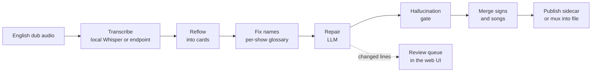

# DubTitlerr

[](https://github.com/XenaRathon/DubTitlerr)
[](https://github.com/SaxxyToo/DubTitlerr/tags)
[](#images)
[](LICENSE)


DubTitlerr transcribes English dub audio into subtitles and merges on-screen signs and songs into the same track.

## The problem

The English subtitles shipped with most anime translate the Japanese script, not the English dub, so watching dubbed with them on gives you two scripts at once.
Meanwhile the translated on-screen signs and songs live on a separate track, and most players show only one subtitle track at a time.
DubTitlerr produces one track that carries the dub dialogue with the signs and songs merged in.

## What this fork adds

Upstream DubTitlerr bakes a Whisper model into a ~13 GB image, needs an NVIDIA GPU for transcription, and muxes the result into the video file. This fork keeps all of that working but adds these things:

| Addition | Why | Where |
| --- | --- | --- |
| **Endpoint ASR backend** (`ASR_BACKEND=endpoint`) | Transcribe through any OpenAI-compatible `/audio/transcriptions` — OpenRouter, a llama-swap whisper, a Nous gateway — so a node needs no model, no torch, no GPU and no CUDA | `dubtitlerr/pipeline/generate.py` |
| **Lite image** (`Dockerfile.lite`) | 936 MB instead of 13.1 GB. The full image's runtime packages and review UI, no model baked in | `Dockerfile.lite` |
| **Sidecar delivery and adoption** (`OUTPUT_MODE=sidecar`, `ADOPT_DUB_EN=1`) | Publish `<episode>.dub.en.ass` beside the video instead of rewriting it, and run an existing sidecar from another pipeline through repair + signs merge | `merge_pass.sh`, `dubtitlerr/pipeline/mux.py`, `dubtitlerr/pipeline/publish_gate.py` |
| **Outbound notifications** | Send Discord, ntfy or generic-webhook messages when a sweep or merge pass ends or fails, configured in Settings > Connect with a per-provider triggers list and Test button | `dubtitlerr/core/notify.py`, `web/src/pages/settings/NotificationsPanel.svelte` |
| **Agent-facing `/api/v1`** | A versioned, additive REST surface with a served OpenAPI document, so an agent or script can read status, queue, history and library and issue `run.request` / `system.restart` / `notification.test` with `X-Api-Key` | `dubtitlerr/review/review_api_v1.py`, `dubtitlerr/review/openapi.json` |

Everything downstream of transcription — reflow, glossary correction, LLM repair, hallucination gate, signs/songs merge, QC — is unchanged and runs identically on both backends.

## How it works



- Transcribe the English dub audio, either in-process with Whisper (large-v3-turbo by default) or through an OpenAI-compatible endpoint, then reflow words into clean cards (at most 2 lines, 42 chars, about 17 cps, never shown before spoken).
- Correct names against a per-show glossary (curated hard_fixes plus a guarded fuzzy match, mined from your files and wiki-verified).
- Repair low-confidence and name-suspect lines with an LLM over any OpenAI-compatible endpoint, anchored on the embedded fansub dialogue when present.
- Drop hallucinated music, silence, and blocklist lines, collapse runaway repeats, and flag the uncertain for review.
- Merge the on-screen signs and song lyrics into the same subtitle.
- Publish `<episode>.dub.en.ass` beside the video (sidecar mode) or mux it in as a default Dubtitles track with the MKV fonts.
- Re-run safely: a version-stamped `.dubtitles.done` sidecar makes the pipeline idempotent and incremental.

## ASR backends

`ASR_BACKEND` selects where transcription happens. Everything else in the pipeline is backend-agnostic.

| Variable | Default | Meaning |
| --- | --- | --- |
| `ASR_BACKEND` | `local` | `local` uses in-process faster-whisper; `endpoint` posts to an OpenAI-compatible transcription API |
| `ASR_URL` | `https://openrouter.ai/api/v1/audio/transcriptions` | Endpoint URL. Must be the full `/audio/transcriptions` path |
| `ASR_MODEL` | `openai/whisper-1` | Model name sent to the endpoint (`whisper-large-v3-turbo` for llama-swap) |
| `ASR_KEY_ENV` | `OPENROUTER_API_KEY` | Name of the environment variable holding the key; only that variable is read. Set it empty for a keyless endpoint. A key is only sent over https, or plain http to loopback: any other URL refuses the run before an episode is touched |
| `ASR_TIMEOUT` | `900` | Per-request timeout in seconds |
| `ASR_REFERER` | fork repo URL | Sent as `HTTP-Referer` to OpenRouter only |

Notes:

- Audio is converted to a 32 kbps mono mp3 before upload. A 24-minute episode is ~46 MB as 16 kHz wav and ~5.5 MB as that mp3; OpenRouter rejects uploads over 25 MB.
- The request asks for `verbose_json` with both word and segment granularity. An endpoint that returns only segment timestamps still works — each segment becomes one timed "word", which the reflow stage handles. Ask for both, because `no_speech_prob` lives on segments alone.
- The local model is never loaded in endpoint mode, and `faster_whisper` is an optional import, so the lite image can run the same code.
- `lastrun.json` records `backend`, `model` and `url` instead of a decoder name, so a run's provenance says which endpoint produced it.

Example — OpenRouter:

```sh
ASR_BACKEND=endpoint
ASR_URL=https://openrouter.ai/api/v1/audio/transcriptions
ASR_MODEL=openai/whisper-1
ASR_KEY_ENV=OPENROUTER_API_KEY
OPENROUTER_API_KEY=sk-or-v1-...
```

Example — a llama-swap whisper on the LAN (no key):

```sh
ASR_BACKEND=endpoint
ASR_URL=http://your-host:11434/v1/audio/transcriptions
ASR_MODEL=whisper-large-v3-turbo
ASR_KEY_ENV=          # keyless; a key is never sent over plain http to another machine
```

Measured on an 892-episode library: local CPU int8 at beam 7 runs 3.2× realtime; llama-swap's `whisper-large-v3-turbo` on a current GPU runs ~11× realtime; OpenRouter `whisper-1` costs $0.006/min (~$0.14 per 24-minute episode).

Which model to point the endpoint at, and what it costs you in accuracy or time, is measured in [Choosing an ASR model](docs/wiki/Choosing-an-ASR-Model.md) with the per-entrant numbers in [ASR bakeoff data](docs/wiki/ASR-bakeoff-data.md).

## Images

Neither image is published; both are built from this repository.

| Image | Size | Contains | Use |
| --- | --- | --- | --- |
| `dubtitlerr` (`Dockerfile.builder`) | ~13 GB | Whisper model baked in, torch, ctranslate2, the review UI | `ASR_BACKEND=local` |
| `dubtitlerr:lite` (`Dockerfile.lite`) | 936 MB | `python:3.11-slim` + ffmpeg, mkvtoolnix, wamerican, tzdata, pysubs2, jellyfish + the review UI + the pipeline scripts | `ASR_BACKEND=endpoint` |

```sh
# full image, local ASR
docker compose up -d --build

# lite image, endpoint ASR
docker build -f Dockerfile.lite -t dubtitlerr:lite .
docker run -d --name dubtitlerr --network host \
  -v /path/to/anime:/media/anime-tv -v /path/to/config:/config \
  -e ANIME_ROOT=/media/anime-tv -e MERGE_ROOTS=/media/anime-tv \
  -e ASR_BACKEND=endpoint -e ASR_URL=https://openrouter.ai/api/v1/audio/transcriptions \
  -e ASR_MODEL=openai/whisper-1 -e OPENROUTER_API_KEY=sk-or-v1-... \
  -e OUTPUT_MODE=sidecar -e SIDECAR_SUFFIX=.dub.en \
  dubtitlerr:lite
```

`Dockerfile.fork` is a thin overlay for exercising a change on a host that already has a release image: it adds this fork's pipeline scripts without rebuilding the model or the UI.

Both images need `mkvtoolnix` — the merge stage shells out to `mkvmerge` to read the video's subtitle streams and attachments. A lite build without it fails at the first merge pass with `FATAL: mkvmerge not found — image is misbuilt`.

**Run the published release, or build your own.** Releases are published to GHCR by the release
workflow: `ghcr.io/saxxytoo/dubtitlerr:v0.4.0` (and `:latest`) for the full image,
`ghcr.io/saxxytoo/dubtitlerr:v0.4.0-lite` (and `:latest-lite`) for the lite image. Pull what you
deploy:

```sh
docker pull ghcr.io/saxxytoo/dubtitlerr:v0.4.0
```

Both images carry OCI labels (`org.opencontainers.image.version`, `…revision`), so `docker inspect`
answers which release an image is without starting it. Building locally (the quickstart above) is the
development path; pass `--build-arg DUBTITLERR_VERSION=$(python3 -m dubtitlerr --version | cut -d' ' -f2)
--build-arg VCS_REF=$(git rev-parse --short HEAD)` when you do, so the labels stay true. The tag
convention and the full release procedure are in [Cut a release](docs/wiki/How-To-Guides.md#cut-a-release).

The two images install the same runtime packages, serve the same review UI and share one health check; `tests/test_dockerfile_copy.py` fails when they drift. Both entrypoints are the supervisor and ignore arguments, so run a one-off command with `docker run --rm --entrypoint sh dubtitlerr:lite -c '...'`.

## Requirements

- Transcription: **either** an NVIDIA GPU with CUDA for local Whisper (6 GB is enough at int8) **or** an OpenAI-compatible transcription endpoint. With `ASR_BACKEND=endpoint` there is no GPU, no model and no CUDA dependency at all.
- An OpenAI-compatible chat endpoint for repair (llama.cpp serving qwen3-4b-instruct by default, or a hosted API with a key). A hosted API receives the lines it repairs.
- ffmpeg and mkvtoolnix; both are baked into each image.

## Quickstart

```sh
git clone https://github.com/SaxxyToo/DubTitlerr && cd DubTitlerr
cp .env.example .env
# edit .env: MEDIA_ROOT and ANIME_ROOT
docker compose up -d --build
```

Then open `http://<host>:8842/review/setup` to create the admin account. `compose.yaml` and `.env.example` carry the full variable set; [Reference](docs/wiki/Reference.md) explains each one, and [Your first show](docs/wiki/Your-First-Show.md) is the end-to-end walkthrough.

## Documentation

| Page | What is there |
| --- | --- |
| [Home](docs/wiki/Home.md) | Start here: install path, per-episode pipeline, requirements. |
| [Your first show](docs/wiki/Your-First-Show.md) | Full walkthrough: one season from model server to published track. |
| [How-to guides](docs/wiki/How-To-Guides.md) | Recipes for one problem each (queue, repair backend, accounts, webhooks, notifications, agent access). |
| [Reference](docs/wiki/Reference.md) | Every variable, glossary field, sidecar, stage outcome, notification field, and route. |
| [Why it works this way](docs/wiki/Why-It-Works-This-Way.md) | The reasoning behind the guards, queues, and defaults. |
| [Choosing an ASR model](docs/wiki/Choosing-an-ASR-Model.md) | What to transcribe with, local or over an endpoint. |
| [Choosing a repair model](docs/wiki/Choosing-a-repair-model.md) | What rewrites the doubtful lines, and why names decide it. |
| [ASR bakeoff data](docs/wiki/ASR-bakeoff-data.md) | The measurements behind those defaults, per entrant and per card. |
| [Design decisions](docs/wiki/Design-decisions.md) | The decisions that are expensive to rediscover. |
| [Agent notes](AGENTS.md) | The rules for changing the code. |

## Status

Beta. The endpoint backend, the lite image and sidecar delivery are newer than the rest of the pipeline and have been run on a full library pass, not just unit tests. The version stamps are real — a change that raises one re-processes affected episodes — so pin a tag rather than tracking `main`.

## License

GPL-3.0; see [LICENSE](LICENSE).
